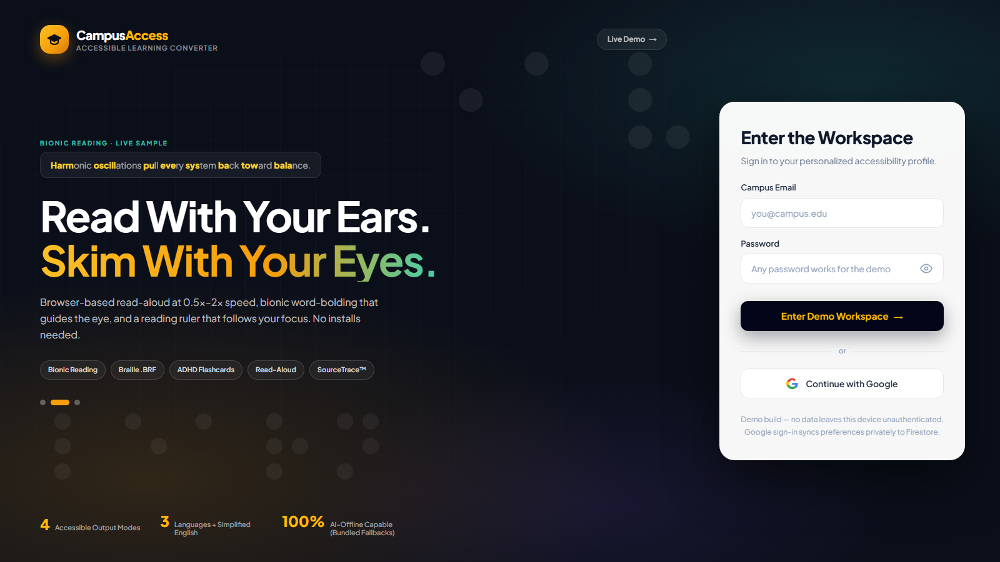
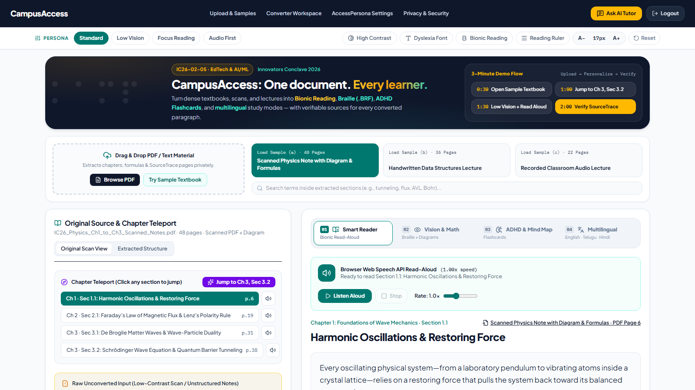

<div align="center">

# 🎓 CampusAccess

**One document. Every learner.**

*Accessible Learning Material Converter — Innovators Conclave 2026 · Problem ID: IC26-02-05 · EdTech & AI/ML*

**🔴 LIVE**: [https://campusaccess-rso3.onrender.com](https://campusaccess-rso3.onrender.com)

</div>

## 📖 The Problem
University textbooks, scanned notes, and lecture PDFs are inaccessible to students with **dyslexia, low vision, ADHD** — dense layouts, tiny fonts, no audio, no braille, no simplification.

## 💡 The Solution
CampusAccess converts **one document** into multiple personalized accessible formats:

| Feature | Description |
|---|---|
| 🅰️ **AccessPersona Presets** | One-click profiles: Standard, Low Vision, Focus Reading, Audio First |
| 👁️ **Bionic Reading** | Bold prefixes that guide the eye for dyslexic readers |
| ✋ **Reading Ruler** | Mouse-following highlight bar |
| 🔠 **Vision & Math Braille** | Valid Grade-1 **.BRF export** + Unicode braille preview |
| 🃏 **Focus Flashcards** | Bite-sized checkpoint cards with progress tracking (designed for ADHD learners, loved by everyone) |
| 🌐 **Multilingual Simplifier** | English → Telugu / Hindi simple-language versions |
| 🔊 **Read Aloud** | Web Speech API TTS with 0.5x–2x speed control |
| 🕵️ **SourceTrace™** | Every section shows its exact source quote + PDF page citation — **zero hallucination** |
| 🤖 **AI Study Tutor** | Gemini-powered chatbot with context of the active section |
| 🔒 **Privacy Gate** | Zero-trust consent flow before entering the workspace |

## 🛠️ Tech Stack
- **Frontend:** React 19 + TypeScript + Vite + Tailwind CSS v4
- **Backend:** Express + tsx (REST APIs, AI fallbacks)
- **AI:** Google Gemini (`@google/genai`) with verified bundled fallbacks
- **Auth & Cloud:** Firebase Auth (Google) + Firestore sync
- **Accessibility:** Web Speech API, live toolbar presets

### Screenshots

| Login Experience | Converter Workspace |
|---|---|
|  |  |

### 🚀 Run Locally
```bash
npm install
npm run dev
```
Open http://localhost:3000 — works **without** a Gemini key (bundled verified fallbacks).

**Deployed (single-service, Render):** build `npm install && npm run build` · start `npm start` with `NODE_ENV=production` + `GEMINI_API_KEY`. Blueprint included in `render.yaml`. Firebase authorized-domain required for Google sign-in.

## 📂 Project Structure
```
├── server.ts                 # Express API + Vite middleware
├── src/
│   ├── App.tsx               # Main workspace UI
│   ├── firebase.ts           # Auth + Firestore sync
│   ├── components/           # Login, tabs, preview, chatbot
│   ├── data/                 # Bundled sample textbooks
│   └── utils/                # Accessibility logic, braille, parsing
├── docs/Architecture.md      # System design
└── firestore.rules           # Security rules
```

## 🧑‍🤝‍🧑 Team
- **Seelam Prem Dharma** — Lead Developer & Team Captain
- *Initial UI concepts prototyped in Google AI Studio; full implementation, architecture, and deployment by the team.*

## 📜 License
Apache-2.0
